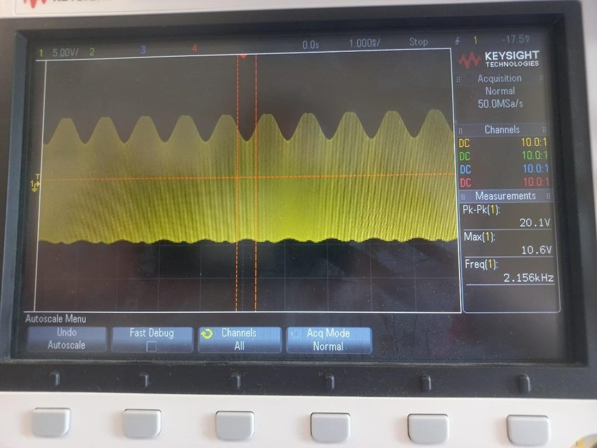
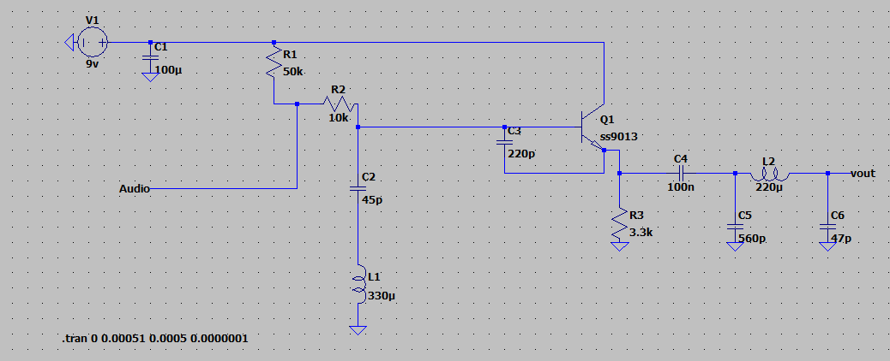
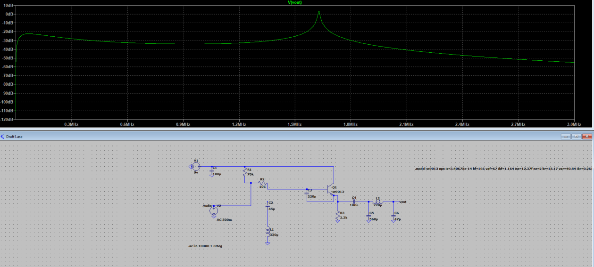
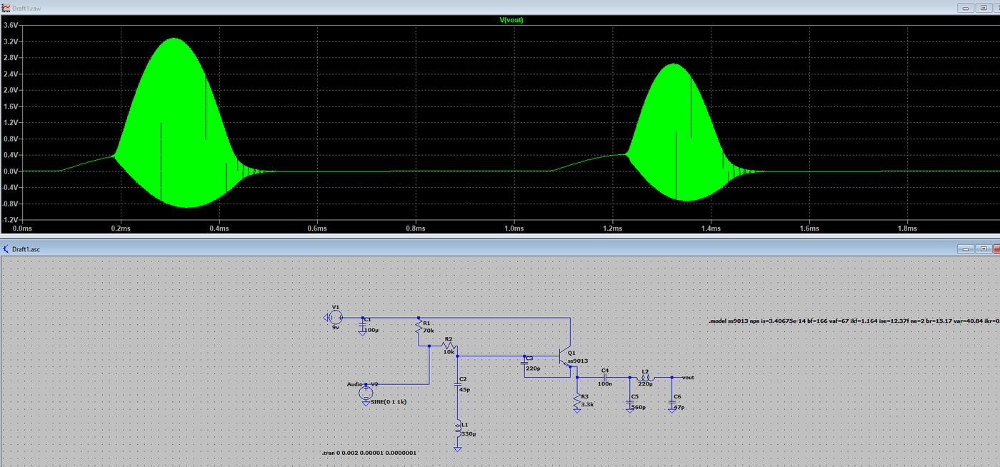
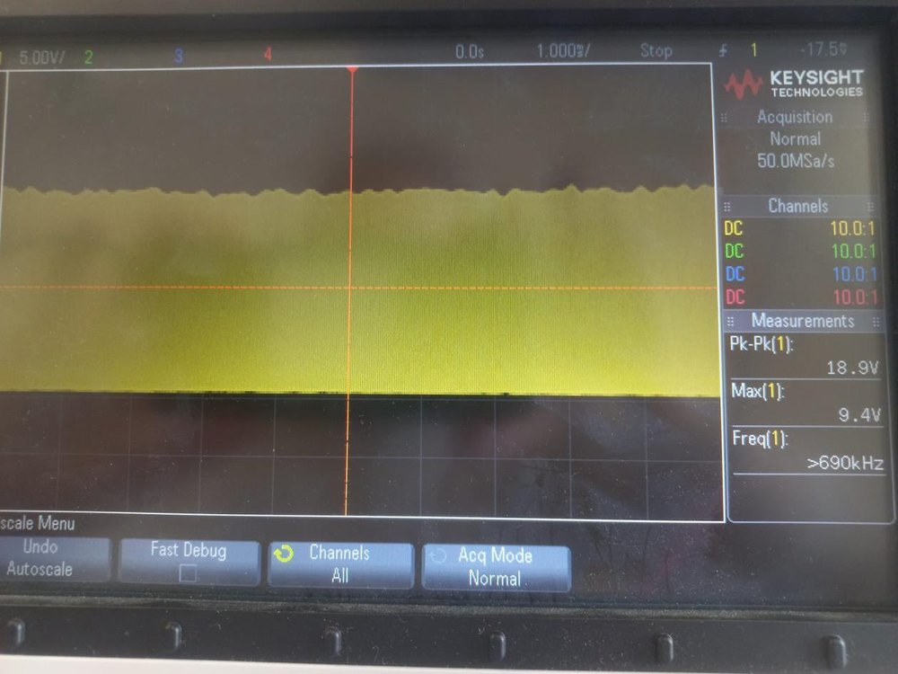
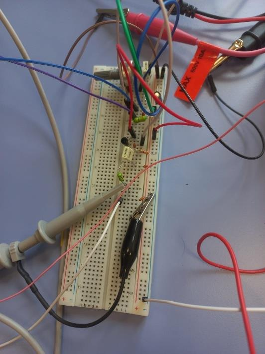

# AM Radio Transmitter

> **A course project (ELEC 310, Analog Electronics, Koç University).** A small AM transmitter
> built from individual components, simulated in LTspice and tested on the bench.



## What it does

AM radio sends sound by changing the strength of a high-frequency carrier wave in step with the
audio. This circuit does exactly that with a single transistor:

- An **LC oscillator** (inductor plus a variable capacitor) makes the carrier, tunable around
  the AM band (about 1.3 MHz in the demo).
- The **audio signal** is added at the transistor's base, so it shapes the carrier's amplitude.
- A **pi filter** after the transistor cleans up the output before the antenna.

The design started from a well-known single-transistor transmitter
([LEAP: single transistor AM transmitter](https://leap.tardate.com/radio/am/singletransistortransmitter/)),
which I re-derived, biased and simulated stage by stage.

## Simulation



| Carrier only | Carrier + audio |
|---|---|
|  |  |

## Bench test

| Modulated audio | Breadboard build |
|---|---|
|  |  |

## Repository structure

```
am-radio-transmitter/
├── ltspice/                 # LTspice schematics for the three test cases
│   ├── transient_with_only_carrier.asc
│   ├── transient_with_only_sine_wave.asc
│   └── transient_with_both_signals.asc
└── docs/
    ├── ELEC310_AM_Transmitter_Report.pdf
    └── images/
```

Open any `.asc` file in LTspice and run the transient simulation.

---

**Author:** Yaşar Aykut Altuntop · MSc student, Biomedical Sciences and Engineering, Koç University  
[LinkedIn](https://linkedin.com/in/aykutaltuntop) · [GitHub](https://github.com/Aykut0)
